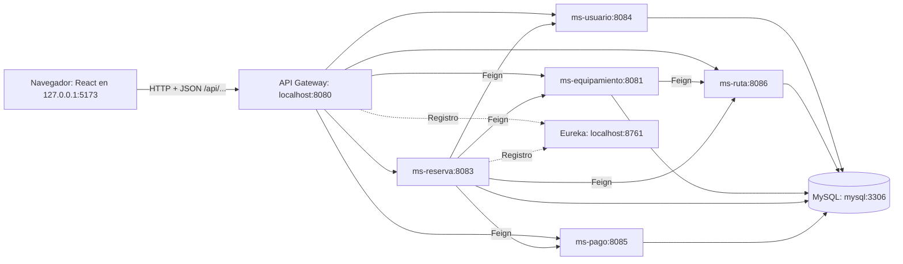
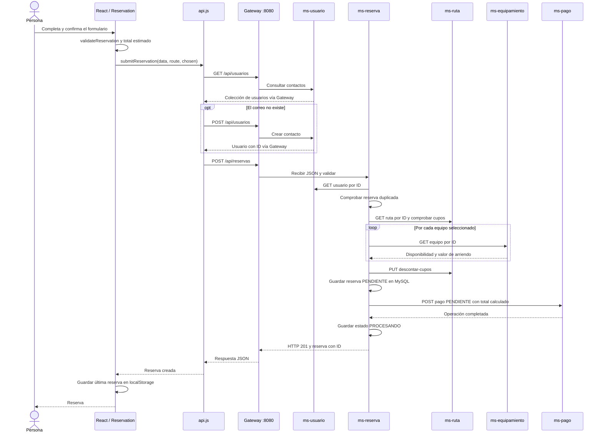

# Cómo se conectan el frontend y el backend de Voy y Vuelvo

Guía técnica de la implementación actual. Actualizada el 12 de noviembre de 2026. Los caminos de esta guía parten de la raíz del repositorio, que contiene `frontend/` y `voyYvuelvo/`.

## Índice

1. [Qué funciones están conectadas](#1-qué-funciones-están-conectadas)
2. [Arquitectura y direcciones](#2-arquitectura-y-direcciones)
3. [Configuración del entorno](#3-configuración-del-entorno)
4. [Archivos y responsabilidades](#4-archivos-y-responsabilidades)
5. [Funciones JavaScript que realizan la conexión](#5-funciones-javascript-que-realizan-la-conexión)
6. [Métodos HTTP y contratos](#6-métodos-http-y-contratos)
7. [Carga de una pantalla de reserva](#7-carga-de-una-pantalla-de-reserva)
8. [Creación completa de una reserva](#8-creación-completa-de-una-reserva)
9. [Comunicación entre microservicios](#9-comunicación-entre-microservicios)
10. [Persistencia y datos iniciales](#10-persistencia-y-datos-iniciales)
11. [CORS, autenticación y puertos](#11-cors-autenticación-y-puertos)
12. [Errores, borradores y límites actuales](#12-errores-borradores-y-límites-actuales)
13. [Verificación manual y automática](#13-verificación-manual-y-automática)
14. [Cómo continuar la integración](#14-cómo-continuar-la-integración)

## 1. Qué funciones están conectadas

La integración HTTP implementada en la interfaz corresponde al flujo de reservas. El proyecto también contiene funciones que trabajan con datos del navegador. Activar la API no cambia automáticamente la persistencia de todas las pantallas.

| Función visible                        | Fuente de datos y comportamiento actuales                                    |
| -------------------------------------- | ---------------------------------------------------------------------------- |
| Portada y listado de rutas             | Catálogos iniciales de `frontend/src/data/`                                  |
| Pantalla `/rutas/:id`                  | Parte de una ruta local y consulta sus datos actuales al backend             |
| Equipamiento recomendado para reservar | Microservicio de equipamiento mediante el Gateway                            |
| Contacto de la reserva                 | Busca o crea un usuario en el microservicio de usuarios                      |
| Crear reserva                          | Microservicio de reservas; coordina cupos, equipamiento y pago               |
| Registro, login y roles de la interfaz | Cuentas locales del navegador; no llaman a `/auth/login` ni `/auth/register` |
| Administración de productos y usuarios | Estado React y almacenamiento local del navegador                            |
| Carrito                                | Almacenamiento local; no genera un pedido ni cobra dinero                    |
| Contacto                               | Guarda una simulación local; no envía correo                                 |
| Confirmación de pago                   | Existe en el backend, pero no hay una pantalla de pago integrada en React    |

Los productos de la tienda y los equipamientos de arriendo son modelos distintos. Cambiar un producto en el panel local no modifica automáticamente `ms-equipamiento`.

## 2. Arquitectura y direcciones



El diagrama muestra las llamadas principales del flujo. Los cinco microservicios y el Gateway se registran en Eureka; se dibujan dos registros como ejemplo para mantenerlo legible. El Gateway también utiliza su propio esquema MySQL para la autenticación implementada en el backend.

Hay dos espacios de direcciones:

| Desde dónde se hace la llamada | Dirección utilizada           | Motivo                                     |
| ------------------------------ | ----------------------------- | ------------------------------------------ |
| Navegador del usuario          | `http://localhost:8080`       | Puerto del Gateway publicado en el equipo  |
| Navegador para ver React       | `http://127.0.0.1:5173`       | Servidor Vite del frontend                 |
| Gateway dentro de Docker       | `http://ms-reserva:8083`      | Nombre DNS del servicio en la red Compose  |
| Microservicio hacia MySQL      | `jdbc:mysql://mysql:3306/...` | Nombre DNS del contenedor de base de datos |
| Microservicio hacia Eureka     | `http://eureka:8761/eureka/`  | Nombre DNS del servicio de registro        |

`localhost` dentro de un contenedor apunta a ese mismo contenedor. Por eso las aplicaciones Java utilizan `mysql`, `eureka` y `ms-ruta`, mientras que el navegador utiliza los puertos publicados en el equipo.

### Papel real de Eureka

Eureka permite observar las aplicaciones registradas y su estado. Actualmente, las rutas del Gateway tienen URI explícitas como `http://ms-ruta:8086`, `discovery.locator.enabled` está desactivado y los clientes Feign también declaran `url` explícita. Por tanto, las llamadas de esta implementación utilizan los nombres de servicio de Docker directamente; no resuelven dinámicamente destinos `lb://...` desde Eureka.

## 3. Configuración del entorno

El archivo local `frontend/.env` debe contener:

```dotenv
VITE_API_URL=http://localhost:8080
```

La plantilla versionada es [`.env.example`](../.env.example). Su valor está vacío para permitir una demostración sin backend. Copiarla no activa la API hasta completar la dirección.

Vite expone la variable a JavaScript mediante `import.meta.env.VITE_API_URL`. Las variables `VITE_` forman parte del código que recibe el navegador; esta variable contiene una dirección pública de conexión, no una contraseña.

| Configuración                        | Efecto                                                                       |
| ------------------------------------ | ---------------------------------------------------------------------------- |
| `VITE_API_URL` vacía                 | Se permite guardar un borrador local de reserva                              |
| `VITE_API_URL=http://localhost:8080` | Las reservas intentan comunicarse con el Gateway local                       |
| `.env.test`                          | Mantiene la dirección vacía para las pruebas Vitest con respuestas simuladas |
| `npm run test:integration`           | Carga el entorno de desarrollo y consulta servicios reales                   |

Después de modificar `.env`, detén Vite con `Ctrl+C` y vuelve a ejecutar `npm run dev`. Un build también incorpora la dirección durante la compilación: para cambiarla en una publicación hay que recompilar. `localhost` en el navegador apunta al equipo de quien visita la página, por lo que una instalación remota necesita la URL alcanzable de su backend.

## 4. Archivos y responsabilidades

### Frontend

| Archivo                                                                          | Responsabilidad                                                                    |
| -------------------------------------------------------------------------------- | ---------------------------------------------------------------------------------- |
| [`main.jsx`](../src/main.jsx)                                                    | Monta React, React Router, Bootstrap y el proveedor de estado                      |
| [`App.jsx`](../src/App.jsx)                                                      | Asocia `/rutas/:id` a la pantalla de reserva                                       |
| [`Reservation.jsx`](../src/pages/Reservation.jsx)                                | Consulta datos, coordina el formulario, calcula totales y maneja el envío          |
| [`ReservationForm.jsx`](../src/components/organisms/ReservationForm.jsx)         | Presenta los campos, el total y el botón de envío; recibe acciones por propiedades |
| [`RentalEquipmentList.jsx`](../src/components/organisms/RentalEquipmentList.jsx) | Presenta las opciones de arriendo y comunica la selección                          |
| [`api.js`](../src/services/api.js)                                               | Centraliza `fetch`, las colecciones HAL y la creación de la reserva                |
| [`validation.js`](../src/utils/validation.js)                                    | Valida contacto, fecha futura y cantidad de personas                               |
| [`storage.js`](../src/services/storage.js)                                       | Lee y escribe JSON en el almacenamiento del navegador                              |
| [`Store.jsx`](../src/context/Store.jsx)                                          | Mantiene catálogo, carrito y sesión locales                                        |
| [`check-integration.mjs`](../scripts/check-integration.mjs)                      | Comprueba la integración real desde Node y Vite                                    |

### Backend

| Ubicación                                                                                                                                 | Responsabilidad                                             |
| ----------------------------------------------------------------------------------------------------------------------------------------- | ----------------------------------------------------------- |
| [`application.yaml` del Gateway](../../voyYvuelvo/infrastructure/api-gateway/src/main/resources/application.yaml)                         | Puerto, rutas HTTP, CORS y registro en Eureka               |
| [`SecurityConfig.java`](../../voyYvuelvo/infrastructure/api-gateway/src/main/java/com/voy_vuelvo/api_getaway/config/SecurityConfig.java)  | Reglas de acceso del Gateway                                |
| [`JwtFilter.java`](../../voyYvuelvo/infrastructure/api-gateway/src/main/java/com/voy_vuelvo/api_getaway/filter/JwtFilter.java)            | Procesamiento de JWT y exclusiones de rutas públicas        |
| [`ReservaController.java`](../../voyYvuelvo/services/ms-reserva/src/main/java/com/voy/velvo/ms_reserva/controller/ReservaController.java) | Recibe y valida la solicitud de reserva                     |
| [`ReservaService.java`](../../voyYvuelvo/services/ms-reserva/src/main/java/com/voy/velvo/ms_reserva/service/ReservaService.java)          | Ejecuta las reglas y coordina los otros microservicios      |
| [`client/` de reservas](../../voyYvuelvo/services/ms-reserva/src/main/java/com/voy/velvo/ms_reserva/client)                               | Interfaces Feign para usuarios, rutas, equipamiento y pagos |
| [`model/` de reservas](../../voyYvuelvo/services/ms-reserva/src/main/java/com/voy/velvo/ms_reserva/model)                                 | Entidad `Reserva` y elementos `ReservaEquipamiento`         |
| [`repository/` de reservas](../../voyYvuelvo/services/ms-reserva/src/main/java/com/voy/velvo/ms_reserva/repository)                       | Acceso a MySQL con Spring Data JPA                          |
| [`docker-compose.yml`](../../voyYvuelvo/docker-compose.yml)                                                                               | Red, puertos, construcción de imágenes y volumen MySQL      |

## 5. Funciones JavaScript que realizan la conexión

### 5.1 `apiEnabled`: elegir entre API y demostración

En `api.js` se obtiene la URL y se retira una barra final si existe:

```js
const base = (import.meta.env.VITE_API_URL || "").replace(/\/$/, "");
export const apiEnabled = Boolean(base);
```

`apiEnabled` indica si hay una dirección configurada. No comprueba que el servidor responda: esa comprobación ocurre al hacer una solicitud.

### 5.2 `request(path, options)`: enviar HTTP con `fetch`

La función concatena la dirección base y una ruta relativa. Por ejemplo:

```js
request("/api/rutas/1");
// Solicitud resultante: GET http://localhost:8080/api/rutas/1
```

Su comportamiento es:

1. Utiliza `fetch`, una API de JavaScript para hacer solicitudes HTTP. No utiliza Axios.
2. Si no se indica método, `fetch` utiliza `GET`.
3. Establece `Content-Type: application/json`. Las opciones pueden añadir o reemplazar encabezados.
4. Aplica `AbortSignal.timeout(10000)`: la operación se interrumpe si excede el tiempo configurado de diez segundos.
5. Comprueba `response.ok`. Un HTTP fuera del rango de éxito produce un error con el código de estado.
6. Devuelve `null` para HTTP `204`.
7. Para otros estados exitosos interpreta el cuerpo como JSON y devuelve el objeto JavaScript.

Ejemplo de envío utilizado para crear un contacto:

```js
await request("/api/usuarios", {
  method: "POST",
  body: JSON.stringify({
    nombre: "Ana Prueba",
    email: "ana.prueba@example.invalid",
    telefono: "900000000",
  }),
});
```

`JSON.stringify` convierte el objeto JavaScript en texto JSON. Spring recibe ese texto y lo convierte al modelo Java. Para las respuestas se hace el recorrido inverso con `response.json()`.

El ayudante espera JSON para los estados exitosos distintos de `204`. Algunos endpoints administrativos del backend devuelven texto; por ejemplo, `DELETE /api/reservas/{id}`. El comprobador de integración utiliza `fetch` sin analizar JSON para limpiar esos registros. Las llamadas activas del flujo React utilizan respuestas JSON.

### 5.3 `embeddedList(data)`: admitir listas y HAL

Los controladores no devuelven todos el mismo formato. Puede llegar una lista directa:

```json
[{ "id": 1, "nombre": "Circuito Base Torres" }]
```

O una colección HAL de Spring HATEOAS:

```json
{
  "_embedded": {
    "rutaList": [{ "id": 1, "nombre": "Circuito Base Torres" }]
  },
  "_links": {
    "self": { "href": "http://localhost:8080/api/rutas" }
  }
}
```

`embeddedList` devuelve directamente un array si ya lo es. En caso contrario busca el primer array dentro de `_embedded`; si no encuentra ninguno, devuelve `[]`. Así el frontend puede recorrer usuarios y equipamientos sin acoplarse al nombre de cada colección HAL. Los enlaces `_links` no se utilizan para construir las llamadas actuales; las rutas están definidas en el servicio JavaScript.

### 5.4 `submitReservation(data, route, equipment)`: coordinar el envío

Esta función:

1. Consulta `GET /api/usuarios`.
2. Normaliza el correo ingresado con `trim().toLowerCase()`.
3. Busca un contacto con ese correo.
4. Si no existe, lo crea con `POST /api/usuarios` enviando nombre, correo y teléfono.
5. Comprueba que la respuesta o el contacto encontrado tenga `id`.
6. Construye el cuerpo de reserva con los IDs y valores necesarios.
7. Envía `POST /api/reservas` y devuelve su respuesta.

El frontend encuentra al usuario listando la colección. Actualmente no utiliza un endpoint específico de búsqueda por correo. Si encuentra un contacto existente, reutiliza su ID y no actualiza automáticamente su nombre o teléfono.

### 5.5 Funciones de la pantalla

En `Reservation.jsx`, `change` actualiza el estado del formulario; `submit` valida y decide entre borrador o API; `restore` recupera un borrador de la ruta actual. El formulario llama a estas funciones mediante propiedades. La lógica HTTP no está escrita dentro de cada campo visual.

## 6. Métodos HTTP y contratos

### Operaciones utilizadas por la interfaz de reservas

| Método | Ruta del Gateway                       | Quién la utiliza        | Datos enviados                         | Resultado esperado                     |
| ------ | -------------------------------------- | ----------------------- | -------------------------------------- | -------------------------------------- |
| `GET`  | `/api/rutas/{id}`                      | Carga de la pantalla    | ID en la URL                           | HTTP `200`, objeto de ruta             |
| `GET`  | `/api/equipamiento/recomendacion/{id}` | Carga de la pantalla    | ID de ruta en la URL                   | HTTP `200`, colección de equipamientos |
| `GET`  | `/api/usuarios`                        | Envío del formulario    | Sin cuerpo                             | HTTP `200`, colección de contactos     |
| `POST` | `/api/usuarios`                        | Si el correo no existe  | Nombre, email y teléfono               | HTTP `200`, usuario con ID y enlaces   |
| `POST` | `/api/reservas`                        | Confirmación de reserva | IDs, personas, fecha, guía y arriendos | HTTP `201`, reserva creada con ID      |

El navegador puede enviar `OPTIONS` antes de las llamadas para verificar CORS. Esa petición la genera el navegador; `submitReservation` no la programa explícitamente.

### Cuerpo de una reserva

Ejemplo ilustrativo. Usa IDs devueltos por tu backend y reemplaza la fecha por un día posterior al actual antes de enviar:

```json
{
  "usuarioId": 1,
  "rutaId": 1,
  "cantidadPersonas": 2,
  "fechaReserva": "2026-12-20",
  "necesitaGuia": false,
  "equipamientos": [{ "equipamientoId": 6, "cantidad": 1 }]
}
```

| Campo              | Origen y significado                                                |
| ------------------ | ------------------------------------------------------------------- |
| `usuarioId`        | ID numérico del contacto encontrado o creado en MySQL               |
| `rutaId`           | ID de la ruta consultada                                            |
| `cantidadPersonas` | Conversión numérica de `data.personas`                              |
| `fechaReserva`     | Fecha elegida, en formato `YYYY-MM-DD`                              |
| `necesitaGuia`     | Booleano del checkbox de solicitud de guía                          |
| `equipamientos`    | Un elemento por equipo seleccionado; la interfaz envía cantidad `1` |

No se envían el precio, el total calculado, el RUT, el pasaporte ni una contraseña en este cuerpo. El backend consulta los precios y calcula el pago. El contacto de reservas utiliza nombre, email y teléfono; es distinto de la cuenta local del registro de React.

Una respuesta exitosa tiene una forma semejante a esta; los IDs y valores varían:

```json
{
  "id": 25,
  "usuarioId": 1,
  "rutaId": 1,
  "cantidadPersonas": 2,
  "fechaReserva": "2026-12-20",
  "necesitaGuia": false,
  "estadoPago": "PROCESANDO",
  "equipamientos": [{ "equipamientoId": 6, "cantidad": 1 }]
}
```

La reserva queda en `PROCESANDO` al finalizar su creación. El registro de pago asociado se crea con estado `PENDIENTE`. Estos estados pertenecen a entidades diferentes y no significan que se haya cobrado dinero.

## 7. Carga de una pantalla de reserva

Al abrir `/rutas/1`:

1. React Router entrega `id = "1"` a la página mediante `useParams`.
2. La página busca la ruta en el catálogo local. Si no existe, presenta `NotFound`; una ruta creada solo en el backend no se incorpora automáticamente al listado local.
3. Inicializa la vista con datos locales y prepara los campos. `fecha` y `personas` también pueden provenir de los parámetros de consulta de la URL.
4. Si `apiEnabled` es verdadero, un `useEffect` ejecuta con `Promise.all` la consulta de ruta y la recomendación de equipamiento en paralelo.
5. Combina la respuesta de ruta con los datos locales. Los campos del backend reemplazan los homónimos; los textos o imágenes que el servidor no envía pueden seguir siendo locales.
6. Normaliza la colección de equipamiento, excluye los elementos con `disponible === false` y asigna una imagen de respaldo si falta.
7. Actualiza el estado React y muestra **Datos consultados al servicio. Cupos sujetos a confirmación al reservar.**

Si cualquiera de las dos consultas falla, `Promise.all` entra en el manejo de error y la vista conserva los datos de demostración. El indicador `active` evita aplicar el resultado después de abandonar la pantalla; no cancela por sí mismo la solicitud que ya salió.

El botón **Confirmar reserva** depende de que exista una URL configurada. Ese texto por sí solo no demuestra que las consultas hayan respondido: también debes comprobar el mensaje de origen de los datos y los estados HTTP en Network.

## 8. Creación completa de una reserva



### Validación en React

`validateReservation` comprueba:

- Nombre no vacío, correo con formato válido y teléfono con el formato admitido.
- Fecha real, en formato canónico y posterior al día actual.
- Cantidad entera de personas, al menos una y sin superar los cupos que la pantalla conoce.

Un error detiene el envío y se presenta en la página. La disponibilidad puede cambiar después de la consulta inicial, por lo que el servidor vuelve a comprobar los cupos al crear la reserva.

### Cálculo del total

La pantalla calcula:

```text
total estimado = precio de ruta × personas + suma de arriendos seleccionados
```

Cada artículo seleccionado se suma una vez porque la interfaz envía cantidad `1`. El backend calcula:

```text
monto del pago = precio actual de ruta × personas
                 + suma(valorArriendo actual × cantidad de cada equipo)
```

La solicitud de guía se almacena como booleano. El total mostrado no incluye una tarifa de guía; el backend actual tampoco agrega un precio por ese concepto.

### Validación y orden en el backend

`ReservaController` utiliza `@RequestBody` para convertir JSON a `Reserva` y `@Valid` para ejecutar las restricciones declaradas en el modelo. `ReservaService` realiza las reglas de negocio en este orden:

1. Consulta que el usuario exista.
2. Rechaza una reserva existente para el mismo usuario y ruta. La búsqueda de duplicados no distingue fechas.
3. Consulta la ruta y verifica sus cupos.
4. Consulta cada equipo, verifica disponibilidad y calcula el monto con los precios del servidor.
5. Solicita a rutas que descuente los cupos.
6. Guarda la reserva con estado `PENDIENTE`.
7. Solicita a pagos que cree el pago pendiente asociado al ID de reserva.
8. Guarda la reserva en `PROCESANDO` y devuelve HTTP `201`.

## 9. Comunicación entre microservicios

Los clientes OpenFeign son interfaces Java anotadas con `@FeignClient`. Sus métodos declaran el verbo y la ruta; Spring construye el cliente HTTP. Los datos recibidos se representan mediante DTO.

Ejemplo real simplificado de `RutaClient` en reservas:

```java
@FeignClient(contextId = "rutaClient", name = "ms-ruta", url = "http://ms-ruta:8086")
public interface RutaClient {
    @GetMapping("/api/rutas/{id}")
    RutaDTO obtenerRutaPorId(@PathVariable("id") Long id);

    @PutMapping("/api/rutas/{id}/descontar-cupos")
    RutaDTO descontarCupos(@PathVariable Long id, @RequestParam Integer cantidad);
}
```

| Quién llama          | Destino y operación                                          | Para qué                                      |
| -------------------- | ------------------------------------------------------------ | --------------------------------------------- |
| Equipamiento         | `GET ms-ruta:8086/api/rutas/{id}`                            | Obtener la dificultad para recomendar equipos |
| Reservas             | `GET ms-usuario:8084/api/usuarios/{id}`                      | Comprobar el contacto                         |
| Reservas             | `GET ms-ruta:8086/api/rutas/{id}`                            | Consultar precio y cupos                      |
| Reservas             | `GET ms-equipamiento:8081/api/equipamiento/{id}`             | Consultar disponibilidad y arriendo           |
| Reservas             | `PUT ms-ruta:8086/api/rutas/{id}/descontar-cupos?cantidad=N` | Descontar lugares                             |
| Reservas             | `POST ms-pago:8085/api/pagos`                                | Crear el pago asociado                        |
| Reservas al eliminar | `PUT ms-ruta:8086/api/rutas/{id}/aumentar-cupos?cantidad=N`  | Devolver los lugares de esa reserva           |

El Gateway enruta las llamadas que llegan desde fuera de Docker. Estas llamadas Feign entre servicios usan directamente la red interna de Compose.

`GET` consulta datos; `POST` crea entidades; `PUT` actualiza datos o ejecuta las operaciones de cupos existentes; `DELETE` elimina registros. El frontend de reservas utiliza `GET` y `POST`. Los `PUT` de cupos se originan en el backend y el comprobador de integración utiliza además `PUT` y `DELETE` sobre sus registros temporales.

## 10. Persistencia y datos iniciales

Cada servicio de negocio utiliza controladores, servicios, repositorios Spring Data JPA y entidades. El repositorio traduce las operaciones a la base MySQL configurada; el navegador no se conecta por JDBC ni recibe credenciales de MySQL.

| Aplicación                | Esquema           |
| ------------------------- | ----------------- |
| Usuarios                  | `bd_usuario`      |
| Rutas                     | `bd_ruta`         |
| Equipamiento              | `bd_equipamiento` |
| Reservas                  | `bd_reserva`      |
| Pagos                     | `bd_pago`         |
| Autenticación del Gateway | `bd_gateway`      |

Aunque los esquemas están separados por servicio, Compose utiliza un solo contenedor MySQL. Las referencias entre servicios son IDs, no relaciones JPA entre bases remotas. La colección de equipos de una reserva se persiste con `@ElementCollection`, `@Embeddable` y una tabla de colección en el esquema de reservas.

Las propiedades JDBC incluyen `createDatabaseIfNotExist=true`; Hibernate utiliza `ddl-auto=update` en el arranque habitual. El volumen `mysql_data` conserva los esquemas y sus registros entre arranques.

En una base nueva, `DataSeedConfig` carga tres rutas si la tabla de rutas está vacía, y `DatosEquipamientoConfig` carga siete equipos si su tabla está vacía. No se reinician tablas que ya contienen registros. La descarga de GitHub no copia usuarios, reservas ni pagos del equipo de desarrollo, ni el contenido de `localStorage` de otro navegador.

### Datos locales del navegador

| Clave                         | Uso                                                        |
| ----------------------------- | ---------------------------------------------------------- |
| `vv-react-products-v2`        | Catálogo administrado localmente                           |
| `voy-vuelvo-carrito-v1`       | Carrito                                                    |
| `vv-react-users-v2`           | Cuentas locales de React                                   |
| `vv-react-session-v2`         | Sesión local en `sessionStorage`                           |
| `voy-vuelvo-reserva-borrador` | Borrador recuperable                                       |
| `voy-vuelvo-ultima-reserva`   | Copia local de la última reserva respondida por el backend |

Guardar la última reserva en el navegador no sustituye su registro en MySQL. Para verificar persistencia se consulta el mismo ID mediante la API.

## 11. CORS, autenticación y puertos

### Por qué se necesita CORS

El origen del frontend es `http://127.0.0.1:5173`; la API utiliza `http://localhost:8080`. Como cambian host y puerto, el navegador los considera orígenes distintos. El Gateway debe responder con encabezados CORS que autoricen la llamada.

La configuración actual se encuentra en `spring.cloud.gateway.globalcors` de `application.yaml`. Permite patrones de origen `*`, métodos `GET`, `POST`, `PUT`, `DELETE`, `OPTIONS` y los encabezados solicitados.

El navegador puede emitir un preflight `OPTIONS`, especialmente porque el ayudante establece `Content-Type: application/json`, incluso para consultas. Solo después de validar la respuesta CORS procede a la llamada correspondiente. Que una consulta funcione en PowerShell o Postman no demuestra por sí solo que el navegador tenga permitido hacerla.

Vite no configura un proxy `/api` en este proyecto: `api.js` llama a la URL completa de `VITE_API_URL`. Por eso se comprueba CORS en el Gateway.

### Autenticación que realmente utiliza la interfaz

El Gateway implementa `/auth/register`, `/auth/login` y JWT. Sin embargo, `SecurityConfig` permite las cinco familias `/api/...` sin token y `JwtFilter` las excluye de la validación JWT. `api.js` no añade un encabezado `Authorization`.

El login de React continúa en `accounts.js` con cuentas del navegador y perfiles académicos. No se ha conectado a la autenticación JWT del Gateway. Esto explica por qué las reservas pueden consultar esas API sin iniciar una sesión JWT.

La ruta raíz `http://localhost:8080/` no contiene el frontend y queda fuera de las rutas públicas declaradas: en la verificación devolvió HTTP `401`. Para la página se abre el puerto `5173`; para examinar el backend se abre `/api/rutas` o `/swagger-ui.html` en el puerto `8080`.

## 12. Errores, borradores y límites actuales

| Situación                                                                     | Comportamiento actual                                           |
| ----------------------------------------------------------------------------- | --------------------------------------------------------------- |
| API sin configurar                                                            | Se guarda un borrador local; no se envía una reserva            |
| Falla la carga de ruta o equipos                                              | Se conservan datos locales y se informa que son de demostración |
| Validación del formulario falla                                               | No se hace el envío de reserva                                  |
| Respuesta HTTP de error                                                       | `request` lanza un error con el estado HTTP                     |
| Error de red, CORS o timeout                                                  | La promesa falla; la pantalla intenta conservar un borrador     |
| El backend no devuelve un ID de reserva                                       | No se presenta el envío como confirmado                         |
| Almacenamiento del navegador lleno o bloqueado                                | `writeStorage` lanza un error; guardar un borrador puede fallar |
| Reserva duplicada o cupos insuficientes                                       | El manejador de reservas devuelve HTTP `409`                    |
| Usuario, ruta o equipo rechazados como inexistentes por la lógica de reservas | HTTP `404` mediante `RecursoNoEncontradoException`              |
| Campos inválidos del modelo de reserva                                        | HTTP `400` desde el manejador de validación                     |

Los códigos no son idénticos en todos los servicios. Por ejemplo, equipamiento devuelve HTTP `400` para algunas búsquedas inexistentes. El ayudante JavaScript no incorpora actualmente el cuerpo de error del servidor al mensaje visible; consulta Network para ver ese detalle.

### Un borrador no confirma una reserva

El borrador reúne los campos del formulario, la ruta, los equipos y el total estimado. `restore` solo lo recupera si su `rutaId` coincide con la ruta abierta. Después de recuperarlo se deben revisar la fecha y disponibilidad nuevamente.

### La operación entre servicios no es atómica

Descontar cupos, guardar una reserva y crear su pago son llamadas y escrituras en servicios diferentes. No existe una transacción distribuida que revierta automáticamente todos esos pasos. Un timeout tampoco permite saber por sí solo si el servidor alcanzó a guardar datos.

Ante un error después de confirmar, consulta reservas, cupos y pagos antes de repetir el envío. Eliminar una reserva devuelve sus cupos mediante `ms-ruta`, pero no elimina automáticamente el pago asociado. Por eso el comprobador de integración retira explícitamente tanto sus pagos como sus reservas.

La actualización general de una reserva y la confirmación de pagos tienen sus propios endpoints. Esta guía no presupone que actualicen automáticamente todas las entidades relacionadas; el flujo comprobado corresponde a creación, consulta y eliminación de los datos temporales.

## 13. Verificación manual y automática

### Manual desde el navegador

1. Sigue el [inicio desde cero del README principal](../../README.md).
2. Abre `http://127.0.0.1:5173/rutas/1` y comprueba que ese ID exista en tu backend.
3. Espera el mensaje **Datos consultados al servicio**.
4. Abre las herramientas de desarrollo, sección **Network / Red**, y filtra por **Fetch/XHR**.
5. Recarga y revisa las dos consultas de ruta y recomendación. Deben devolver HTTP `200` desde el puerto `8080`.
6. Compara nombre, precio, cupos y equipos con los JSON recibidos.
7. Si pruebas el envío, utiliza datos de prueba, una fecha futura y una ruta con cupos. Pulsa confirmar una sola vez.
8. Observa `GET /api/usuarios`, el `POST /api/usuarios` si hacía falta el contacto y el `POST /api/reservas` con respuesta `201`.
9. Consulta el ID devuelto en `/api/reservas/{id}` y revisa el pago asociado en `/api/pagos`.

### Comprobador automático del proyecto

Desde `frontend/`, con Docker y Vite iniciados y `.env` configurado:

```sh
# Consultas reales sin crear registros.
npm run test:integration

# Añade un flujo de escritura con datos temporales propios.
npm run test:integration -- --write-test
```

La opción de escritura solo admite una API local. Utiliza un identificador aleatorio `qa-integracion-...` y un correo `@example.invalid` para distinguir sus registros.

El comprobador carga `api.js` mediante Vite en modo de servidor y utiliza `fetch` real desde Node. Comprueba las cinco API por el Gateway y directamente, registro en Eureka, recomendación entre servicios, encabezados CORS y respuesta HTML de Vite. Con `--write-test` verifica además crear y actualizar un equipo, ejecutar `submitReservation`, guardar el arriendo, generar el pago pendiente con el monto correcto y descontar un cupo.

En `finally` intenta retirar los registros temporales y comprueba la restauración de cupos. Si la API deja de estar disponible durante la limpieza, la prueba falla y deben revisarse sus registros; no se debe asumir que todo se retiró. La última ejecución completa aprobó las **12 comprobaciones**, y una consulta posterior a MySQL confirmó que los contactos y equipos temporales ya no existían.

Esta prueba no hace clics en el navegador ni representa una revisión visual completa. La revisión manual de formularios y Network complementa la verificación HTTP.

### Diferencia con las pruebas unitarias

`npm test` utiliza Vitest, jsdom, `.env.test` y respuestas simuladas. La última suite comprobada aprobó **99 pruebas en ocho archivos**. Las cinco pruebas `ReservaServiceTest` utilizan JUnit y Mockito. Estas suites pueden comprobar reglas sin levantar MySQL; la integración real requiere Docker.

Para diagnosticar el backend desde `voyYvuelvo/`:

```sh
docker compose ps
docker compose logs --tail 100 api-gateway ms-reserva ms-ruta ms-pago ms-usuario ms-equipamiento
docker compose exec -T mysql mysqladmin ping -u root
```

## 14. Cómo continuar la integración

Para ampliar el sistema, los puntos de trabajo están identificados en el código:

1. Un catálogo de rutas completamente remoto debe reemplazar o adaptar `src/data/routes.js` y el listado, además de permitir abrir IDs que todavía no existan en el catálogo local.
2. El login remoto requiere adaptar `accounts.js`, el manejo de sesión y el encabezado de autenticación a los contratos de `/auth/...`.
3. La administración remota requiere adaptar los modelos y servicios de catálogo y usuarios; sus datos actuales no equivalen directamente a los modelos de los microservicios.
4. La confirmación de pago y las actualizaciones de reservas necesitan definir y verificar cómo se mantienen consistentes los estados entre servicios.

Estos puntos describen el alcance pendiente. La documentación no los presenta como funciones ya implementadas.

Para operación diaria consulta [Conexión y comprobaciones](CONEXION-BACKEND.md), y para instalar desde GitHub consulta el [README principal](../../README.md).
