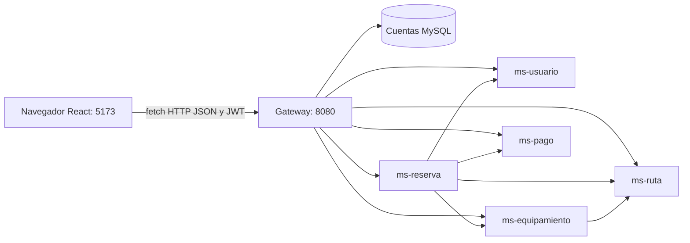
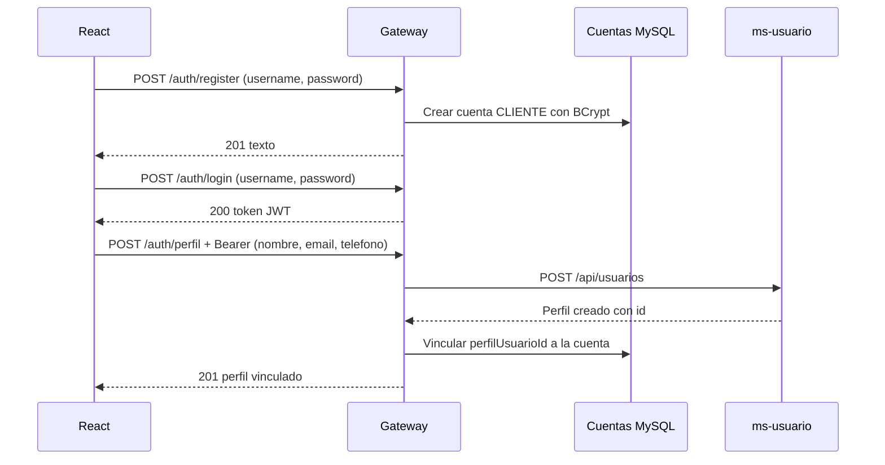

# Integración de frontend y backend

Referencia del código actual, actualizada el 21 de noviembre de 2026 para EP3. Para instalar, utiliza el [README principal](../../README.md). Los ejemplos son explicativos: enviar un registro o una reserva crea datos reales en la base de desarrollo.

## 1. Arquitectura y direcciones



El navegador solo conoce el Gateway. No se conecta directamente a MySQL ni a los puertos internos de los microservicios. Cada servicio almacena sus entidades en su propio esquema del mismo contenedor MySQL. El Gateway tiene además su esquema de cuentas de autenticación.

| Componente             | Dirección desde el equipo | Dirección dentro de Docker    |
| ---------------------- | ------------------------- | ----------------------------- |
| Frontend de desarrollo | `http://127.0.0.1:5173`   | Se ejecuta fuera de Compose   |
| Gateway                | `http://localhost:8080`   | `http://api-gateway:8080`     |
| Eureka                 | `http://localhost:8761`   | `http://eureka:8761`          |
| MySQL                  | `localhost:3306`          | `mysql:3306`                  |
| Usuario                | Sin puerto publicado      | `http://ms-usuario:8084`      |
| Equipamiento           | Sin puerto publicado      | `http://ms-equipamiento:8081` |
| Ruta                   | Sin puerto publicado      | `http://ms-ruta:8086`         |
| Reserva                | Sin puerto publicado      | `http://ms-reserva:8083`      |
| Pago                   | Sin puerto publicado      | `http://ms-pago:8085`         |

Eureka permite observar los seis clientes registrados. Las rutas actuales del Gateway y los clientes HTTP usan direcciones explícitas de Docker; el registro en Eureka no implica que el enrutamiento actual resuelva dinámicamente cada destino desde Eureka.

## 2. Configuración

React lee `VITE_API_URL` mediante `import.meta.env`. Con `http://localhost:8080`, una petición a `/api/rutas` se convierte en `http://localhost:8080/api/rutas`. No hay un proxy de Vite entre ambos. Una URL vacía activa partes locales de demostración; no sustituye los servicios de autenticación remota.

Vite carga variables al iniciar y las incorpora a la compilación. Cambiar `.env` requiere reiniciar desarrollo o recompilar producción. Las variables específicas del modo y las del proceso pueden prevalecer sobre el archivo general. La clave del backend nunca debe tener prefijo `VITE_`.

El Gateway obtiene `JWT_SECRET_BASE64` del entorno que configura Compose. Debe decodificar al menos 32 bytes. `JwtUtil` firma con HS256 y establece una duración de una hora. No existe renovación automática del token. La plantilla `.env.example` del backend no contiene una clave utilizable: cada instalación debe generar una propia.

## 3. Archivos responsables en React

| Archivo                                  | Responsabilidad                                                        |
| ---------------------------------------- | ---------------------------------------------------------------------- |
| `src/services/api.js`                    | Base de URL, `request`, extracción de listas HAL y envío de reservas   |
| `src/services/auth.js`                   | Login con usuario y contraseña; devuelve el JWT                        |
| `src/services/registration.js`           | Coordina registro, login técnico y creación del perfil                 |
| `src/services/accounts.js`               | Usuarios locales de demostración del editor; no autentica contra MySQL |
| `src/components/organisms/LoginForm.jsx` | Recoge credenciales y comunica la sesión a la aplicación               |
| `src/routes/legacy.js`                   | Traduce direcciones HTML históricas a rutas de React                   |

Los componentes y páginas coordinan la interacción; los servicios realizan el intercambio HTTP. `request(path, options)` acepta `token` y añade `Authorization: Bearer <token>` cuando se proporciona. No busca un token automáticamente en localStorage.

Las solicitudes de `api.js` usan `Content-Type: application/json`, leen respuestas JSON y aplican un tiempo límite de 10 segundos por defecto. Una respuesta 204 devuelve `null`. Un HTTP no satisfactorio genera un error con el código de estado; el detalle de negocio no siempre llega completo al usuario. `auth.js` tiene su propio flujo de `fetch`, por lo que no hereda necesariamente ese límite de tiempo.

`embeddedList` acepta tanto arreglos JSON normales como colecciones HAL dentro de `_embedded`. Esto permite consumir las colecciones de Spring Data REST sin depender de un nombre fijo de colección.

## 4. Registro: tres llamadas diferentes



### Cuenta de acceso

`registrarClienteBackend` envía:

```http
POST /auth/register
Content-Type: application/json
```

```json
{
  "username": "cliente_prueba",
  "password": "una-clave-propia"
}
```

El servicio del Gateway valida los datos, codifica la contraseña con BCrypt y asigna `CLIENTE`. El cliente no puede elegir un rol administrativo mediante este formulario. La respuesta satisfactoria es 201 con texto, no con un token ni un perfil. Un nombre de usuario existente produce 409.

### Token técnico y perfil

Después del registro, React llama a `/auth/login` con las mismas credenciales y obtiene un JWT. Con ese token envía:

```http
POST /auth/perfil
Authorization: Bearer <token>
Content-Type: application/json
```

```json
{
  "nombre": "Ana Pérez",
  "email": "ana@example.invalid",
  "telefono": "+56912345678"
}
```

`registration.js` combina nombres y apellidos, normaliza el correo y elimina espacios exteriores. Aunque el formulario valida más campos, como RUT o pasaporte y dirección, el perfil remoto actual solo envía nombre, email y teléfono. No debe suponerse que los demás campos se guardan en MySQL.

El Gateway identifica la cuenta a partir del JWT, exige rol de cliente, crea el usuario de dominio y vincula su identificador mediante `perfilUsuarioId`. La respuesta 201 contiene ese vínculo y los datos del perfil. Ya no se necesita buscar un usuario por correo desde React para decidir a quién pertenece una reserva.

Si falla la vinculación después de crear el perfil, el controlador intenta eliminar ese perfil recién creado. Los pasos no forman una transacción distribuida. Si la cuenta ya se creó y luego falló el login o el perfil, no hay reversión automática de la cuenta ni una pantalla completa de recuperación. Repetir el registro con el mismo usuario devuelve conflicto. Se debe revisar el estado y completar la vinculación con intervención controlada.

El éxito del registro no deja una sesión persistente: el usuario inicia sesión después desde la página de login.

## 5. Login y duración de la sesión

```http
POST /auth/login
Content-Type: application/json
```

```json
{
  "username": "cliente_prueba",
  "password": "una-clave-propia"
}
```

La respuesta 200 tiene la forma `{ "token": "JWT" }`. Credenciales incorrectas producen 401. El backend compara la contraseña con BCrypt y emite un token con identidad, rol y expiración.

El formulario decodifica las claims para decidir qué mostrar y la navegación posterior. Esa lectura en React no valida la firma; la autorización efectiva la hace el Gateway. Modificar el estado del navegador no concede permisos en la API.

La aplicación guarda sesión y JWT en memoria de React. Al refrescar o cerrar la pestaña se pierden. No se guardan en localStorage ni se renuevan automáticamente. Si la sesión caduca hay que iniciar sesión de nuevo. Tras cambiar un rol en MySQL es necesario emitir un token nuevo.

## 6. Lectura del catálogo y del perfil

Las rutas y el equipamiento admiten consultas públicas:

```http
GET /api/rutas
GET /api/rutas/1
GET /api/equipamiento
GET /api/equipamiento/recomendacion/1
```

El Gateway dirige esas peticiones a los servicios correspondientes. La recomendación se resuelve desde equipamiento consultando los datos de la ruta. La pantalla de reserva carga la ruta y las recomendaciones; no interpreta productos locales del carrito como equipamiento remoto.

Cuando hay una sesión de cliente, React también solicita `GET /auth/perfil` con JWT. El Gateway lee el vínculo de esa cuenta y obtiene su perfil desde `ms-usuario`. Sin vínculo devuelve 404. El nombre y contacto del formulario no sustituyen ese vínculo: completar esos campos manualmente no repara una cuenta sin perfil.

## 7. Reserva segura del cliente

El frontend usa `submitReservation(data, route, equipment, token)`. Primero verifica que exista token; después arma el cuerpo y realiza:

```http
POST /auth/reservas
Authorization: Bearer <token>
Content-Type: application/json
```

```json
{
  "rutaId": 1,
  "cantidadPersonas": 2,
  "fechaReserva": "2027-01-15",
  "necesitaGuia": false,
  "equipamientos": [{ "equipamientoId": 1, "cantidad": 1 }]
}
```

React transforma los identificadores y la cantidad de personas a números. Cada equipamiento seleccionado se envía con cantidad 1. No envía `usuarioId`, precio total ni los campos de contacto del formulario en esta petición. El backend calcula la pertenencia y los importes.

`ReservaClienteController` valida el DTO, obtiene la cuenta del JWT, comprueba el rol y recupera su `perfilUsuarioId`. Si no existe perfil vinculado responde 409. Construye entonces una petición interna con el `usuarioId` autorizado y la envía a `ms-reserva` mediante WebClient.

El servicio de reservas consulta usuario, ruta y equipamiento mediante clientes Feign. Comprueba existencia, cupos y disponibilidad, calcula el total según la ruta por persona más equipamiento, descuenta cupos, persiste la reserva y solicita un pago. En el flujo actual la reserva pasa a `PROCESANDO` después de crear el pago.

La regla de duplicados actual considera usuario y ruta; no debe suponerse que permite varias reservas de la misma ruta en fechas diferentes. La confirmación de pago cambia el estado del pago y no representa un cargo bancario ni garantiza una transición automática del estado de la reserva.

Estos pasos involucran distintos servicios y bases. No existe una transacción distribuida que revierta todo ante cualquier fallo. Eliminar una reserva restaura cupos según el servicio, pero no debe asumirse que elimina automáticamente el pago asociado. No uses una prueba automática antigua que cree y borre reservas para concluir que todo queda restaurado.

## 8. Matriz de acceso del Gateway

| Recurso                                                    | Acceso actual            |
| ---------------------------------------------------------- | ------------------------ |
| `POST /auth/register`, `POST /auth/login`                  | Público                  |
| `GET /api/rutas/**`, `GET /api/equipamiento/**`            | Público                  |
| `GET` y `POST /auth/perfil`                                | CLIENTE                  |
| `POST /auth/reservas`                                      | CLIENTE                  |
| `GET /auth/cuentas`                                        | ADMINISTRADOR            |
| `GET /api/reservas/**`                                     | ADMINISTRADOR o VENDEDOR |
| `POST /api/reservas`                                       | ADMINISTRADOR            |
| `/api/usuarios/**`, `/api/pagos/**`                        | ADMINISTRADOR            |
| Modificaciones restantes de rutas, equipamiento y reservas | ADMINISTRADOR            |
| Swagger y especificaciones configuradas                    | Público                  |

Las solicitudes OPTIONS se permiten para CORS. Los recursos no contemplados se deniegan. El filtro JWT verifica firma, expiración y rol reconocido; una cabecera con token inválido también puede provocar rechazo en una consulta que sería pública sin esa cabecera.

No hay credenciales administrativas de demostración aseguradas en la base. Los usuarios de `accounts.js` pertenecen al editor local. La lista de cuentas remotas de administración utiliza `GET /auth/cuentas` y requiere un administrador real.

## 9. CORS

El backend y Vite tienen orígenes distintos porque usan puertos distintos. La configuración de seguridad permite el frontend en `http://localhost:5173` y `http://127.0.0.1:5173`, incluyendo las cabeceras `Content-Type` y `Authorization`.

Antes de enviar algunas peticiones, el navegador hace OPTIONS con el método y las cabeceras deseadas. Si no recibe autorización CORS, bloquea el acceso desde JavaScript aunque el servicio responda por otros medios. Para usar otra dirección, otro puerto de desarrollo o desplegar la web, hay que adaptar los orígenes del Gateway. El preview habitual en 4173 no forma parte automáticamente de los orígenes permitidos para toda la API.

## 10. Datos remotos y datos locales

| Función                                               | Destino                      |
| ----------------------------------------------------- | ---------------------------- |
| Identidad, contraseña BCrypt, rol y vínculo al perfil | MySQL del Gateway            |
| Nombre, correo y teléfono del cliente                 | ms-usuario / MySQL           |
| Rutas, equipamiento, reservas y pagos                 | Microservicios / MySQL       |
| Productos de la tienda y editor local de usuarios     | Almacenamiento del navegador |
| Carrito y mensajes de contacto                        | Almacenamiento del navegador |
| JWT y sesión                                          | Memoria de React             |

La base inicial incorpora rutas y equipamiento cuando sus tablas están vacías; no garantiza usuarios de login. Los datos locales pueden persistir aunque se detenga Docker y no aparecen en MySQL. Un mensaje guardado por contacto no es un correo enviado.

## 11. Verificación y diagnóstico

`npm run test:integration`, con Vite y Docker iniciados, consulta catálogos, ruta, recomendaciones, Eureka y HTML; comprueba el preflight con Authorization y exige rechazo 401 sin token en recursos protegidos. Opcionalmente admite `INTEGRATION_TOKEN` o credenciales de entorno para comprobar acceso de un rol. El JWT lo valida el servidor; el comprobador solo lee la claim del rol para seleccionar las consultas. No muestra el token y no crea ni borra datos de negocio.

No equivale a una prueba completa de registro y reserva. Ese recorrido se verifica manualmente con datos de desarrollo según el [recorrido de revisión](RECORRIDO-DE-REVISION.md). Las pruebas de React usan mocks y no validan MySQL.

| Respuesta o síntoma | Interpretación y siguiente paso                                            |
| ------------------- | -------------------------------------------------------------------------- |
| Error de red        | Revisar URL, puertos, contenedores y CORS                                  |
| 400                 | Revisar campos y validaciones del cuerpo                                   |
| 401                 | Falta token o está vencido/inválido; volver a iniciar sesión               |
| 403                 | Rol sin permiso; revisar la cuenta y emitir un token nuevo si cambió       |
| 404 en perfil       | La cuenta no tiene un perfil disponible                                    |
| 409 en registro     | El usuario ya existe                                                       |
| 409 en reserva      | Revisar vínculo de perfil, cupos y duplicados según el detalle del backend |
| 502                 | Revisar disponibilidad del servicio interno y registros del Gateway        |

Los registros deben consultarse sin compartir contraseñas ni tokens. Los mensajes genéricos de React pueden requerir revisar la respuesta y los logs del backend para determinar la causa exacta.

## 12. Límites actuales

Quedan como mejoras de producto la recuperación del perfil tras un registro parcial, la renovación o restauración de sesión, la consistencia entre reserva y pago y la migración de las funciones locales que se quieran sincronizar. Esta actualización documental describe esos límites; no implementa esos cambios funcionales.
